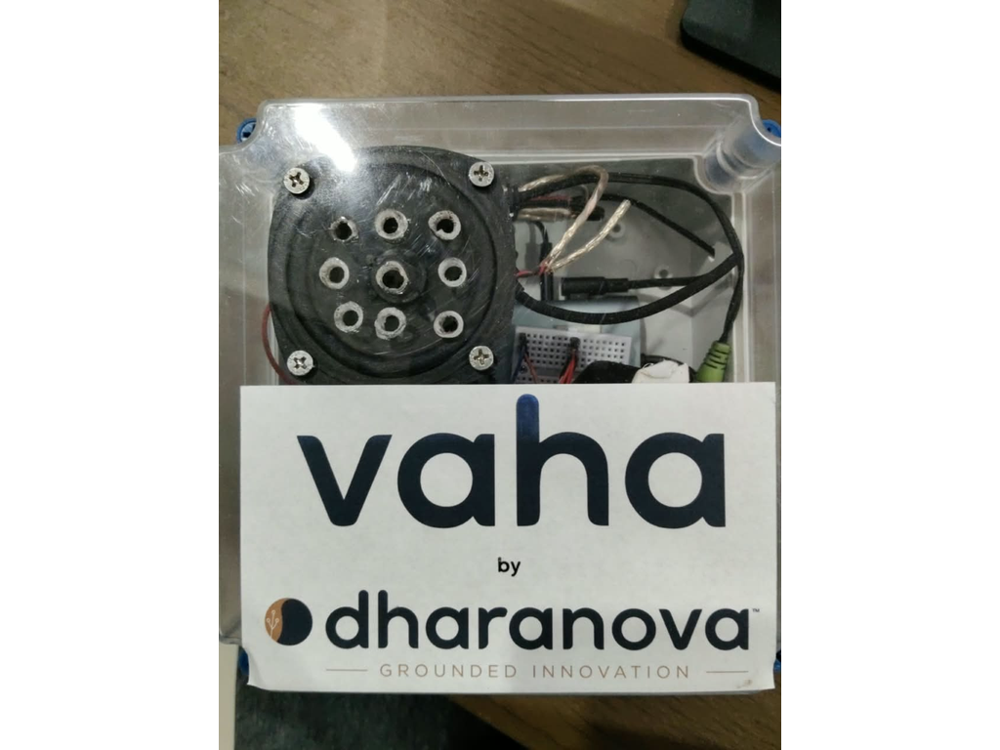
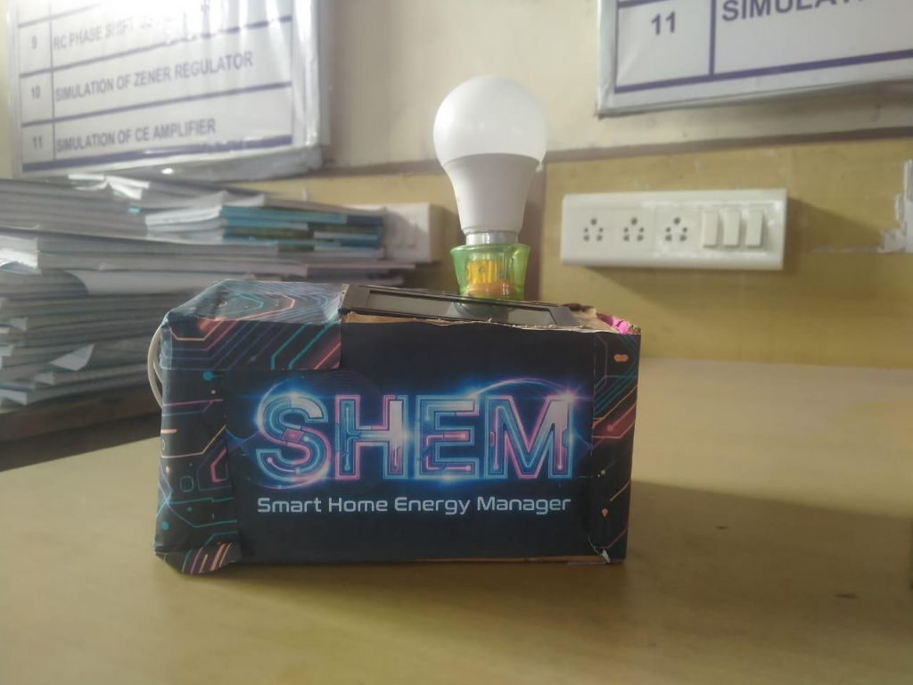
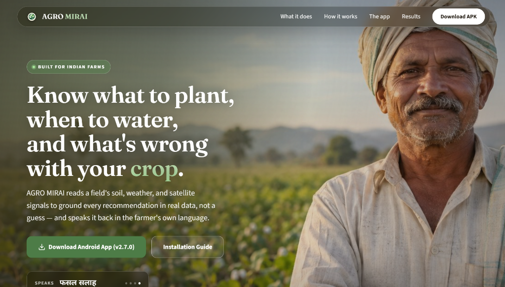
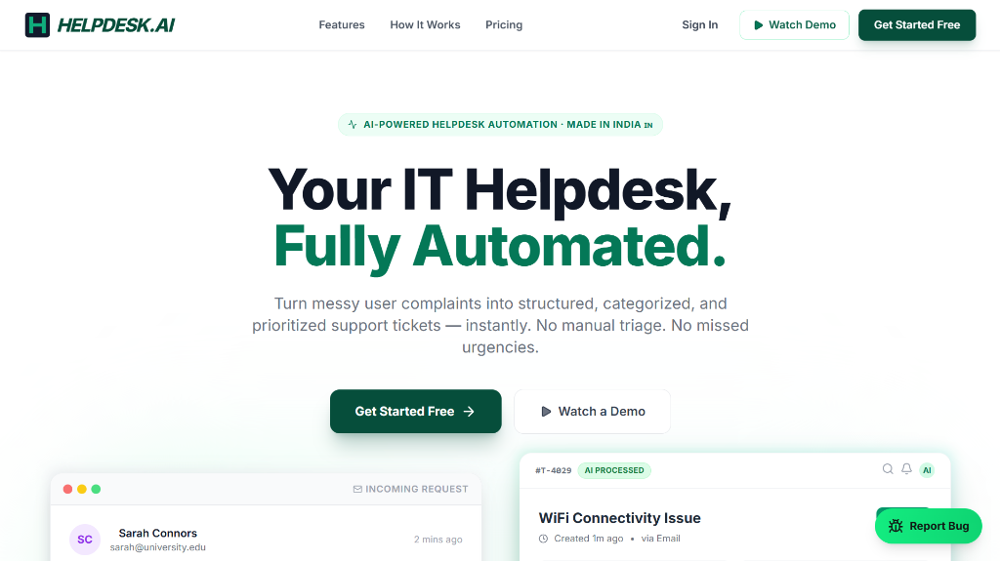

# Ritesh Bonthalakoti

### Embedded Systems Engineer

---

### About

I design custom circuits, write microcontroller firmware in C/C++, and develop IoT hardware at Dharanova. My focus is on physical computing, analog sensor calibration, and edge processing, alongside building production-grade web platforms and autonomous agentic workflows.

---

### Hardware Systems

<table>
<tr>
<td width="50%" valign="top">

  
  <h3><a href="https://github.com/dharanova-code/vaha" target="_blank">VAHA</a></h3>

On-device physical AI terminal engineered for ambient environmental and acoustic processing. Listens for dedicated wake-word triggers, executes on-device speech-to-text transcription, and synchronizes real-time sensor telemetry without cloud dependency.

  <b><a href="https://github.com/dharanova-code/vaha" target="_blank">🔗 Repository: dharanova-code/vaha</a></b>

- **National Recognition**: Selected among the **Top 50 Hardware Projects in India** at the Arduino Physical AI Challenge 2026.
- **Edge Speech Pipeline**: On-device speech transcription with local audio inference and zero cloud latency.
- **Multi-Sensor Array**: Continuous monitoring of acoustic events, ambient temperature, humidity, and airflow.
- **Hardware Integration**: Custom circuit enclosure, sensor routing, and microcontroller firmware.

</td>
<td width="50%" valign="top">

  
  <h3><a href="https://shem1918.vercel.app/" target="_blank">Smart Home Energy Manager (SHEM)</a></h3>

Precision electrical mains energy monitoring and diagnostic system. Calibrated from scratch to compute real-time true RMS electrical metrics, detect anomalous power spikes, and stream load telemetry to remote dashboards.

  <b><a href="https://shem1918.vercel.app/" target="_blank">🔗 Live Dashboard: shem1918.vercel.app</a></b>

- **1st Prize Winner**: Awarded **1st Prize at Project Expo** with a **₹10,000 cash prize**.
- **High-Accuracy Sensing**: On-device true RMS voltage, current, power, and power factor computed with **±5% validated accuracy**.
- **Hardware Circuitry**: Built with ZMPT101B voltage transformer, SCT-013 current sensor, and ESP32 processing.
- **Telemetry & Safety**: Real-time MQTT telemetry streaming, automated overload alerts, and fail-safe relay switching.

</td>
</tr>
</table>

---

### Software Platforms

<table>
<tr>
<td width="50%" valign="top">

  
  <h3><a href="https://agromirai.vercel.app/" target="_blank">AgroMirai</a></h3>

Intelligent agricultural platform designed to empower farmers with data-driven crop health diagnostics, soil analysis, and predictive yield insights through accessible multi-modal interfaces.

  <b><a href="https://agromirai.vercel.app/" target="_blank">🔗 Live Platform: agromirai.vercel.app</a></b>

- **Agricultural Intelligence**: Neural diagnosis of crop diseases and real-time advisory tailored to local conditions.
- **Soil & Climate Modeling**: Real-time integration of ambient sensor data, microclimate tracking, and soil nutrient indexes.
- **Farmer-Centric Architecture**: Built for low-bandwidth rural connectivity with high-accessibility interfaces.
- **Predictive Analytics**: Machine learning models predicting yield trends and pest risk windows.

</td>
<td width="50%" valign="top">

  
  <h3><a href="https://helpdeskaiv1.vercel.app/" target="_blank">Helpdesk.ai</a></h3>

Enterprise neural support orchestrator built during Infosys Springboard. Automates technical support ticket triage, categorizes requests in under 100ms with fine-tuned DistilBERT, and resolves repetitive incidents with generative AI.

  <b><a href="https://helpdeskaiv1.vercel.app/" target="_blank">🔗 Live Platform</a> · <a href="https://github.com/riteshbonthalakoti/HELPDESK.AI" target="_blank">Repository</a></b>

- **Community Traction**: **180+ GitHub Stars** and **300+ Forks** on GitHub.
- **Neural Classification**: Sub-100ms ticket categorization using fine-tuned DistilBERT and named entity recognition.
- **Duplicate Triage**: High-speed ticket clustering and duplicate incident detection via vector cosine similarity.
- **Enterprise Security**: Production architecture featuring a 4-tier Supabase Row-Level Security (RLS) model.

</td>
</tr>
</table>

---

### Technical Stack

<table>
<tr>
<td width="33%" valign="top">
<strong>Hardware &amp; Firmware</strong> 
• ESP32 / ESP-IDF 
• STM32 &amp; ARM Cortex 
• Arduino Architecture 
• Embedded C / C++ 
• FreeRTOS 
• Circuit Prototyping &amp; PCB 
• Sensor Calibration &amp; ADC
</td>
<td width="33%" valign="top">
<strong>Protocols &amp; Edge</strong> 
• I2C / SPI / UART 
• MQTT &amp; WebSockets 
• True RMS Processing 
• Edge ML &amp; Speech-to-Text 
• Signal Conditioning 
• Power Isolation 
• Oscilloscope &amp; Logic Debug
</td>
<td width="33%" valign="top">
<strong>Software &amp; AI Systems</strong> 
• Python &amp; FastAPI 
• TypeScript &amp; Next.js 
• LangChain &amp; Multi-Agents 
• PostgreSQL &amp; Supabase 
• Vector Databases (RAG) 
• Docker &amp; CI/CD 
• Full-Stack Architecture
</td>
</tr>
</table>

---

### Writing

<!-- BLOG-POST-LIST:START -->
- <a href="https://medium.com/@ritesh1918/the-intelligence-supercycle-architecting-the-silicon-based-workforce-and-the-physical-ai-reality-64ec1fae34c4" target="_blank">The Intelligence Supercycle: Architecting the Silicon-Based Workforce and the Physical AI Reality</a>
- <a href="https://medium.com/@ritesh1918/the-ai-revolution-of-2025-5-game-changing-technologies-every-student-should-know-about-a4ba5fbef4cc" target="_blank">The AI Revolution of 2025: 5 Game-Changing Technologies Every Student Should Know About</a>
<!-- BLOG-POST-LIST:END -->

<i>Automated daily via <a href="https://github.com/gautamkrishnar/blog-post-workflow" target="_blank">blog-post-workflow</a></i>

---

&nbsp;

&nbsp;

&nbsp;

&nbsp;

